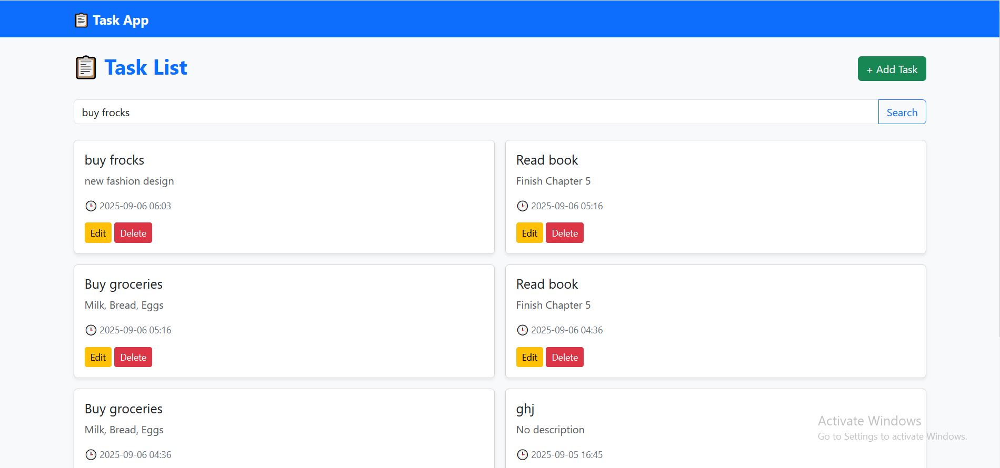
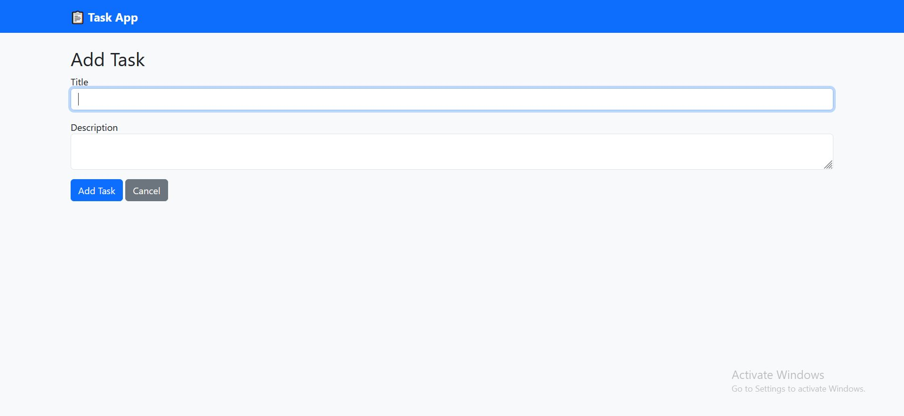
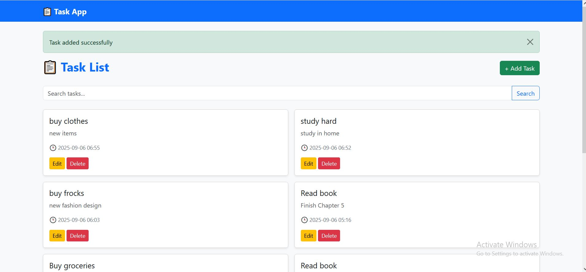
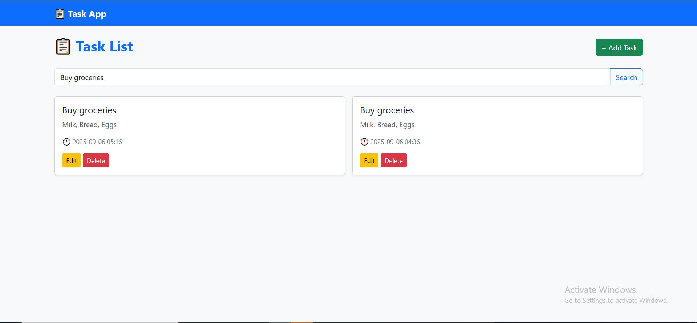
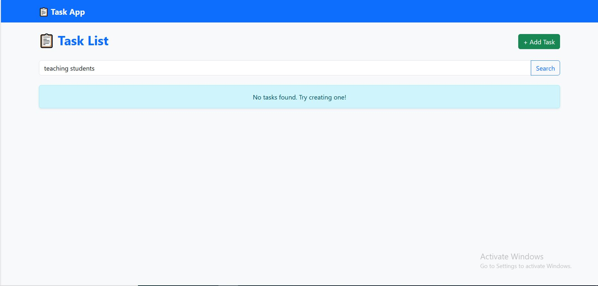
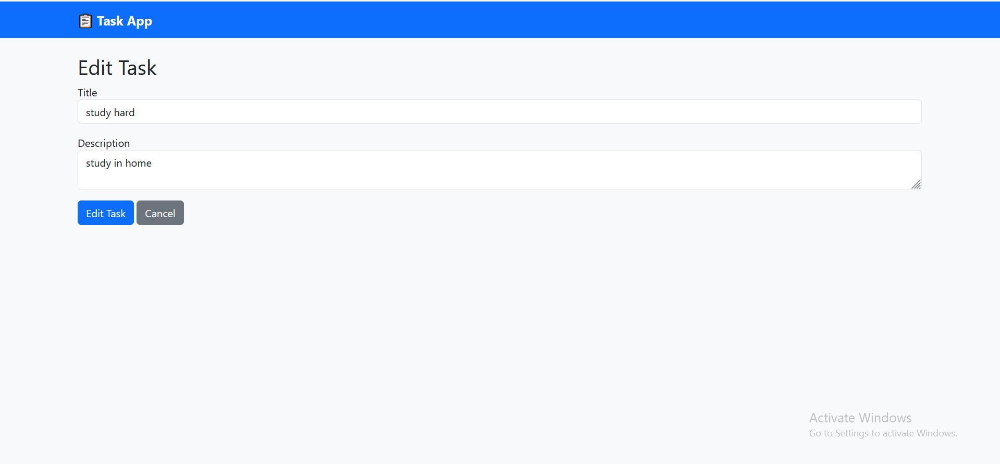
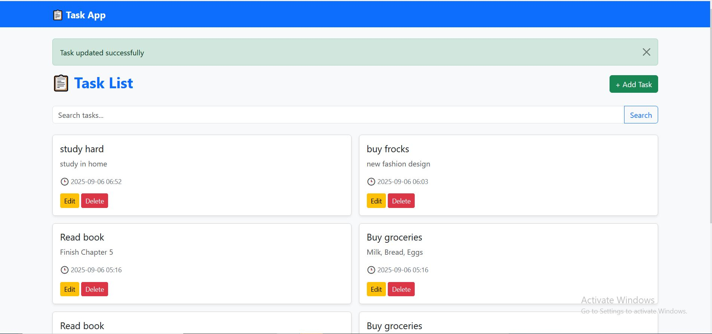
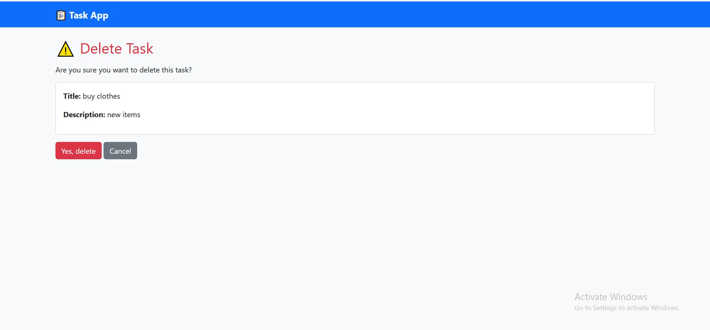
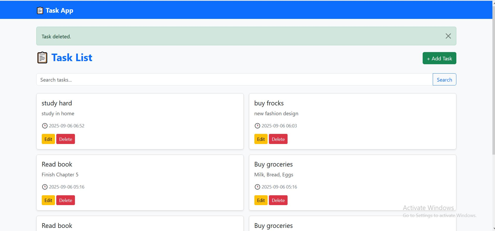

# flask-lite-project

## 📌 Project Summary
This is a **Flask Lite CRUD application** for managing tasks.  
It allows users to **Create, Read, Update, Delete**, and **search/filter** tasks.  
The project is built using **Flask, SQLAlchemy, SQLite, Jinja2, and Bootstrap 5**.

## 👥 Team Members

- K.E.Kumarasinghe (Team Lead) - ASP/2022/149
- R.M.C.N. Abeyvickrama - ASP/2022/152
- G.A.M.A. Dissanayake - ASB/2022/169
- P.N. Wickramarathna - ASP/2022/137
- W.D.N.O.Wanniarachchi - ASP/2022/142

  Instructor GitHub: akalanka-h
  
## ⚙️ Tech Stack
- Python 3.x
- Flask
- SQLAlchemy (SQLite)
- Jinja2 Templates
- Bootstrap (via CDN)
  
## Features
- List all tasks in a responsive card layout  
- Search/filter tasks by title or description  
- Add new tasks with server-side validation  
- Edit existing tasks  
- Delete tasks with a confirmation page  
- Flash messages for success/error notifications  
- Database seeding with sample tasks  

## Project Structure
~~~
project_root/
├─ tasks.db
├─ app.py # Flask app with routes
├─ models.py # SQLAlchemy Task model
├─ seed.py # Seed script to populate DB
├─ requirements.txt # Project dependencies
├─ README.md # This file
├─ .gitignore
├─ templates/
│ ├─ base.html
│ ├─ list.html
│ ├─ form.html
│ └─ delete_confirm.html
└─ static/ # Optional for CSS/JS

~~~
## 📸 Screenshots

### 🏠 Task List Page


### ➕ Add Task Form



### 🔍 Search Tasks



### 📝 Edit Task Form



### ❌ Delete Confirmation




## 🚀 Setup & Run

1.  **Clone the repository**
    ```bash
    git clone https://github.com/Kalpi2002/flask-lite-project
    cd flask-lite-project
    ```
2.  **Create and activate a virtual environment**
    ```bash
    # For macOS/Linux
    python3 -m venv venv
    source venv/bin/activate

    # For Windows
    # python -m venv venv
    # .\venv\Scripts\activate
    ```

3.  **Install the required dependencies**
    ```bash
    pip install -r requirements.txt
    ```

4.  **Initialize and seed the database**
    Run the seed script to create the `tasks.db` file and populate it with sample data.
    ```bash
    python seed.py
    ```

5.  **Run the application**
    This will start the Flask development server.
    ```bash
    python app.py
    ```
    The application will be running at `http://127.0.0.1:5000`.
   
    
## 🚀 Contribution Table

- Member	                  -Contribution
- K.E. Kumarasinghe (Lead)	-Repo setup, DB config, seed script, README, Create form
- R.M.C.N. Abeyvickrama	    -Edit form, Templates & CSS
- G.A.M.A. Dissanayake     -Search/filter functionality
- P.N. Wickramarathna	      -List page layout & functionality
- W.D.N.O. Wanniarachchi	  -Delete feature with confirmation
  
## 📋 Project Board

We use a GitHub Project Board to track the progress of the Flask Lite Project.  
All tasks/features are represented as cards and linked to their respective branches and issues.  

**Columns:**
- Completed: All implemented features are here.  
- (Optional) Tasks Planned / In Progress can be used for ongoing work.  

**Tasks & Features:**

| Task / Feature | Branch | Status | Notes |
|----------------|--------|--------|------|
| Create form | feature/create-form | Completed | Merged into main |
| Edit form | feature/edit-form | Completed | Merged into main |
| List page | feature/list-page | Completed | Merged into main |
| Search/Filter | feature/search-filter | Completed | Merged into main |
| Delete task | feature/delete-task | Completed | Merged into main |
| Template CSS | feature/template-css | Completed | Merged into main |
| Update README.md | n/a | Completed | Documentation finalized |
| Database seeding | n/a | Completed | Seeded sample data |
| Flash messages | n/a | Completed | Success/error notifications |

Each feature has an **Issue** for tracking and is linked to its **branch** for traceability.  
The board provides a visual roadmap of the project workflow, helping the team stay organized and ensuring all tasks are completed.

📌 **Access:** The Project Board can be viewed [here](https://github.com/Kalpi2002/flask-lite-project/projects) (private repository, instructor access granted).


## 📈 Progress Log

**Sep 2**
- Repo created
- Members added
- Base Flask app runs
- Defined the database schema with a `Task` model (`models.py`)
- Configured the Flask app to connect to a SQLite database (`app.py`)
- Created a seed script to populate the database with sample data (`seed.py`)
- Implemented a basic route (`/tasks`) to fetch and display all tasks from the database

**Sep 3**
- Added Create Task functionality with validation and flash messages
- Added Edit Task functionality with prefilled form
- Updated templates with Bootstrap styling

**Sep 4**
- Added Delete Task with confirmation page
- Implemented Search/Filter on list page
- Refined template styling for cards, forms, and buttons

**Sep 5–6**
- Polished UI: spacing, responsive design, flash messages
- Tested all CRUD flows and search functionality
- Updated README with screenshots and contribution table

**Sep 7**
- Final testing of all CRUD + search flows
- Verified flash messages and responsive layout
- Committed and pushed final code to main
- Confirmed instructor access to private repository

